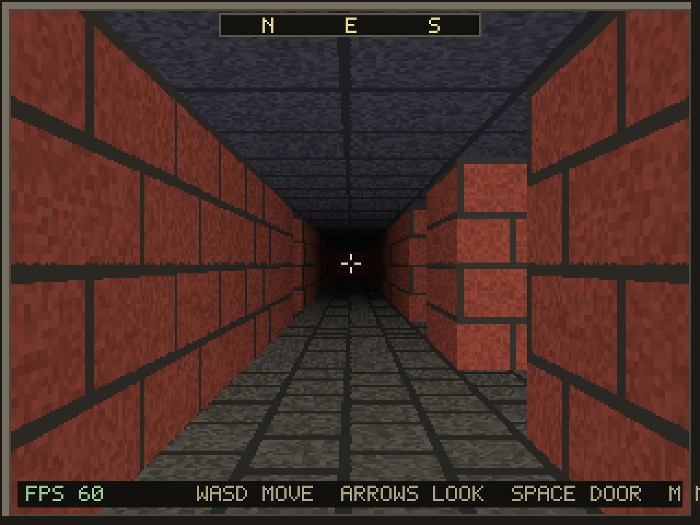
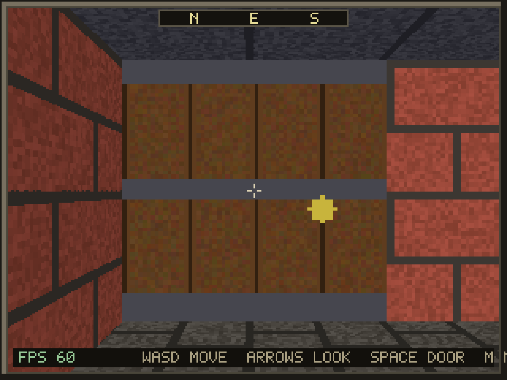
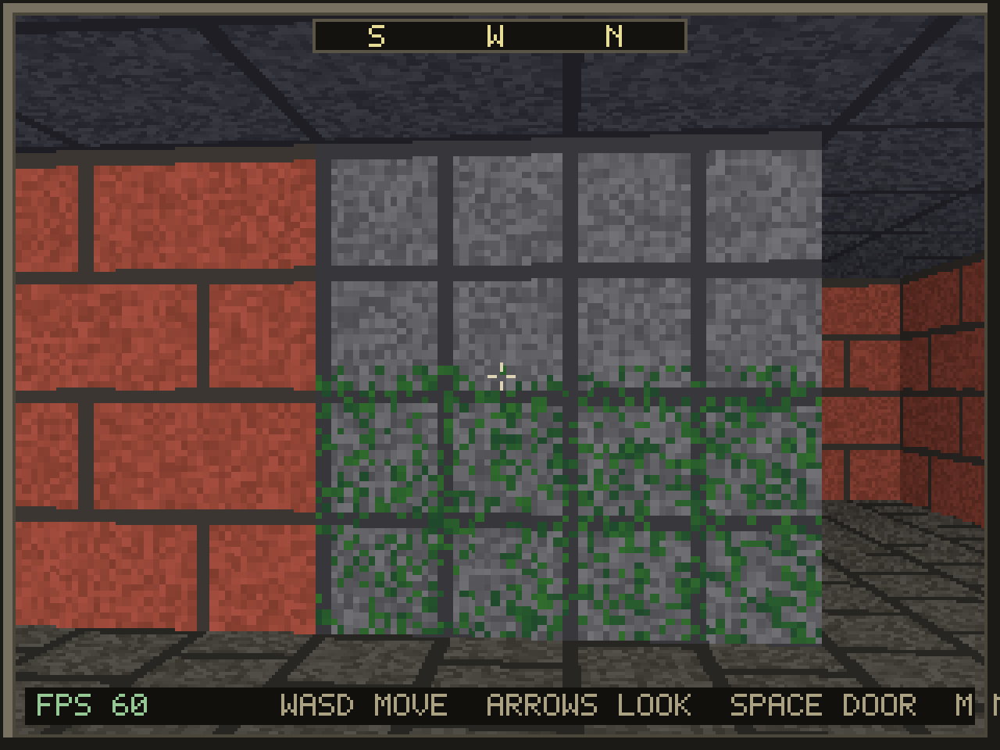

# Crawler

A first person dungeon crawler written in Free Pascal (OBJFPC mode) with a
textured raycasting engine. It renders at 320x240 into a software framebuffer
and upscales with nearest-neighbour filtering for a crisp retro look. The
camera movement mirrors the step-and-turn feel of the old MS-DOS dungeons such
as Realms of Arkania: Shadows over Riva, while keeping smooth free movement.

## Screenshots

The images below are the 320x240 framebuffer upscaled 4x with nearest-neighbour
filtering, the same way the game presents it.

| | |
|---|---|
|  |  |
| A brick corridor with the compass, crosshair and overhead automap. | Distance fog fading a long corridor toward black. |
|  |  |
| A planked door with iron bands and a handle, framed by the corridor. | Green-flecked moss on stone next to a brick wall. |

## Features

- Textured raycasting walls (DDA grid cast) with per-face shading.
- Floor and ceiling casting with the same distance fog as the walls.
- Turn-based grid movement: step tile by tile and turn in 90 degree steps, each
  tweened so the motion stays smooth. Holding the right mouse button free-looks
  anywhere; stepping or turning realigns the view to the nearest facing. A
  cursor allows clicking the scene.
- Textures generated by an offline tool into a `game.pak` archive and loaded
  from that file at runtime, using the custom PAK and PIC formats.
- Openable doors, a scrolling compass and a crosshair.
- Fog of war: a line-of-sight light radius reveals tiles, which fade to a dim
  remembered state out of sight. A small translucent minimap shows the ground
  near the party, and a fullscreen map shows the whole explored level.
- A HUD drawn with a built-in 5x7 bitmap font.
- A title screen and character creation for a party of up to four, choosing
  from data-driven species, classes and backgrounds, with a quick-start option.
- Items and monsters loaded from compiled tables, with per-class starting kits.
- Turn-based combat on the AX&X rules: side initiative, range bands, attacks and
  saves, brush-with-death, morale, guard and potion actions.
- Keyword dialog with NPCs, a buy shop, story flags and a quest journal. The
  game now starts in a town hub with a barkeep and an elder.
- Save and load, including the party, gold, flags, journal, position and the
  explored fog of every visited map, from the title screen or F5 and F9.
- Roguelike dynamic maps (rooms, caves, mazes) generated from a seed. The
  version and seed are stored in the save, so a level regenerates identically
  and its explored fog persists across visits.
- A software audio mixer with sound-effect channels and a synth music channel.
  Effects are generated at startup and music is a built-in sequence per zone,
  so no audio files ship. The game runs silently if no sound device is present.
  An Options screen on the title menu sets the master, music and effect volumes.
- Resting recovers party health between fights, and traps on marked tiles test a
  Dodge save, deal damage and can poison the lead member until cured by rest.
- A game clock drives a day-night cycle that lights and darkens outdoor maps,
  and a 29.53 day moon. The moon is tracked everywhere, so a full moon
  transforms characters cursed with lycanthropy even underground. Skylight and
  moonwell tiles admit sun or moonlight into dark places for light puzzles. The
  clock and moon show on the HUD and are saved.
- Six connected zones: a town hub, a seaside, a forest, a crypt, dynamic caves
  and mazes, and an infernal depth, with a short relic quest that ends the game
  when the shard is returned to the town elder.

## Controls

| Input | Action |
|-------|--------|
| W / S or Up / Down | Step forward / back one tile |
| A / D | Strafe one tile left / right |
| Q / E or Left / Right arrows | Turn 90 degrees |
| Mouse | Move the cursor over the scene |
| Left click | Interact with the tile under the cursor (open a door) |
| Right button (hold) | Free look; stepping or turning realigns the view |
| Space | Open or close a door directly ahead |
| M | Toggle the small minimap |
| Tab | Open or close the fullscreen map |
| J | Open or close the quest journal |
| R | Rest to recover health, when no foe is near |
| F5 / F9 | Save / load the game |
| Space or click | Talk to an NPC ahead or under the cursor |
| C | Force a test encounter (while a party exists) |
| Esc | Quit |

## Requirements

- Free Pascal Compiler (fpc) 3.2 or newer.
- The SDL2 runtime shared library. The game loads `libSDL2-2.0.so.0` at
  runtime with dlopen, so no `-dev` package or Pascal SDL bindings are needed.
  On Debian/Ubuntu: `sudo apt install libsdl2-2.0-0`.

## Build and run

```sh
make        # builds build/crawler
make run    # builds and runs
make clean  # removes the build directory
```

## Layout

| File | Role |
|------|------|
| `crawler.lpr` | Platform layer: SDL setup, window, frame loop, framebuffer upload. |
| `src/game.pas` | Game state machine: routes input, update and render per state. |
| `src/sdl2min.pas` | Minimal runtime binding to the SDL2 shared library. |
| `src/gfx.pas` | Framebuffer, drawing primitives and the bitmap font. |
| `src/pak.pas` | Pack archive reader, plus a writer for the tools. |
| `src/pic.pas` | Custom image codec (PackBits, direct or indexed colour). |
| `src/mapfmt.pas` | Compiled map format: encode and decode map lumps. |
| `src/maptext.pas` | Parser for the text map format, used by the tool. |
| `src/rng.pas` | Deterministic xorshift PRNG with independent streams. |
| `src/rules.pas` | AX&X rules math: abilities, classes, dice resolution. |
| `src/items.pas` | Item database and table codec, loaded from the pak. |
| `src/itemtext.pas` | Parser for the text item table, used by the tool. |
| `src/party.pas` | Characters, derived stats and character creation. |
| `src/chardata.pas` | Species, class and background tables (data-driven). |
| `src/chartext.pas` | Parsers for the species/class/background tables. |
| `src/monsters.pas` | Monster database and table codec. |
| `src/montext.pas` | Parser for the monster table, used by the tool. |
| `src/combat.pas` | Turn-based AX&X combat: initiative, bands, morale. |
| `src/flags.pas` | Story flags and the quest journal. |
| `src/dialog.pas` | Conversation data, decoder and runtime. |
| `src/dialogtext.pas` | Parser for the text conversation format. |
| `src/mapstate.pas` | Per-map fog, door and seed snapshots across visits. |
| `src/save.pas` | Save and load of the whole game to a file. |
| `src/worldfmt.pas` | Dynamic-map manifest table and codec. |
| `src/worldtext.pas` | Parser for the dynamic-map manifest. |
| `src/mapgen.pas` | Seeded roguelike generators (rooms, cave, maze). |
| `src/audio.pas` | Software mixer: procedural SFX and synth music channels. |
| `src/texgen.pas` | Procedural texture generation, used by the asset tool. |
| `src/textures.pas` | Runtime texture cache, loaded from the pak. |
| `tools/mkassets.pas` | Offline tool: builds `game.pak` from generated art. |
| `src/world.pas` | Map grid, player camera, movement and collision. |
| `src/raycast.pas` | The textured raycasting renderer. |
| `src/hud.pas` | Border, compass, crosshair and automap overlay. |

## Notes

Maps live in `content/maps/*.map` as text and are compiled into `game.pak` by
the asset tool. Each map is a grid of tile characters: `0` is open floor,
`1`-`3` select wall textures (brick, stone, moss) and `4` is a door. A map also
names entry markers and portals that move the party to another map, so the
world is several maps loaded on demand rather than one hardcoded grid.
