# Cities of the Sunless Depths

A first person dungeon crawler written in Free Pascal (OBJFPC mode) with a
PSX-style textured polygon renderer. The build is named `crawler`. It renders at 320x240 into a software framebuffer
and upscales with nearest-neighbour filtering for a crisp retro look. The
camera movement mirrors the step-and-turn feel of the old MS-DOS dungeons such
as Realms of Arkania: Shadows over Riva, while keeping smooth free movement.

The engine is renderer and content agnostic and targets three desktop hosts
today (Linux, Windows and macOS), with MS-DOS and PlayStation 1 as the
long-term goals the architecture is kept ready for. The software rasterizer's
per-pixel hot path runs in fixed point, so the renderer is shaped for those
FPU-less targets.

## Screenshots

The images are the 320x240 framebuffer upscaled 4x with nearest-neighbour
filtering, the same way the game presents it.

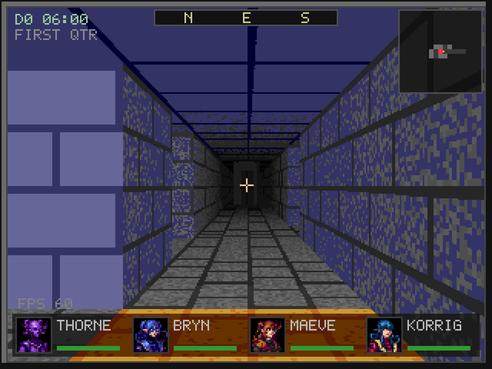

The six zones each wear their own tileset, one colour scheme over the shared
wall and floor patterns, so even a generated map themes from its area.

| | |
|---|---|
| 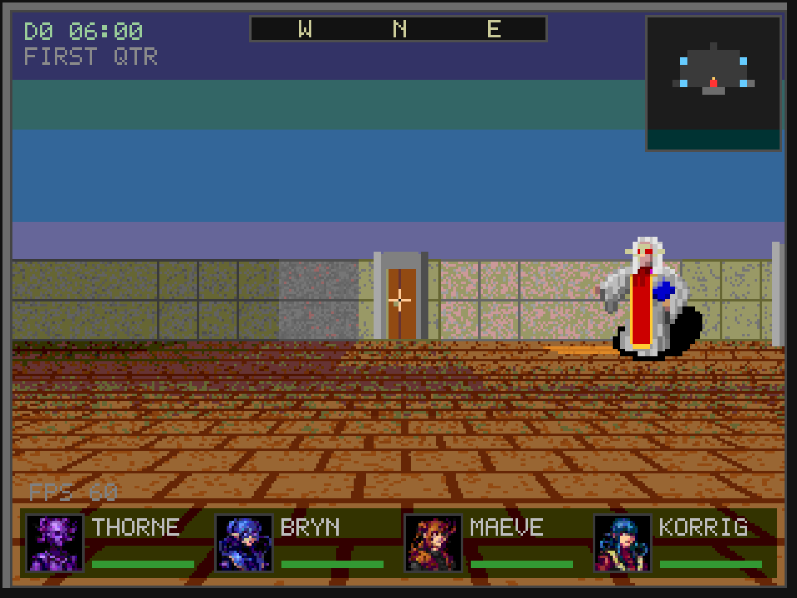 | 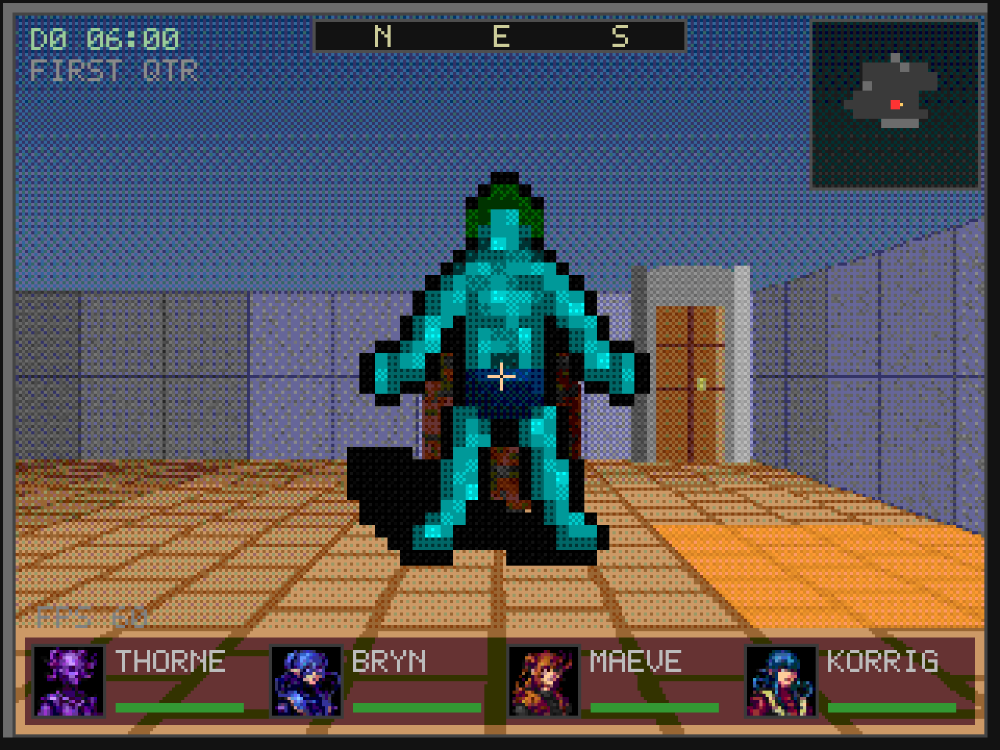 |
| The town hub, where the party starts near the elder and the tavern. | The seaside, with its ferryman and a wreck down the strand. |
| 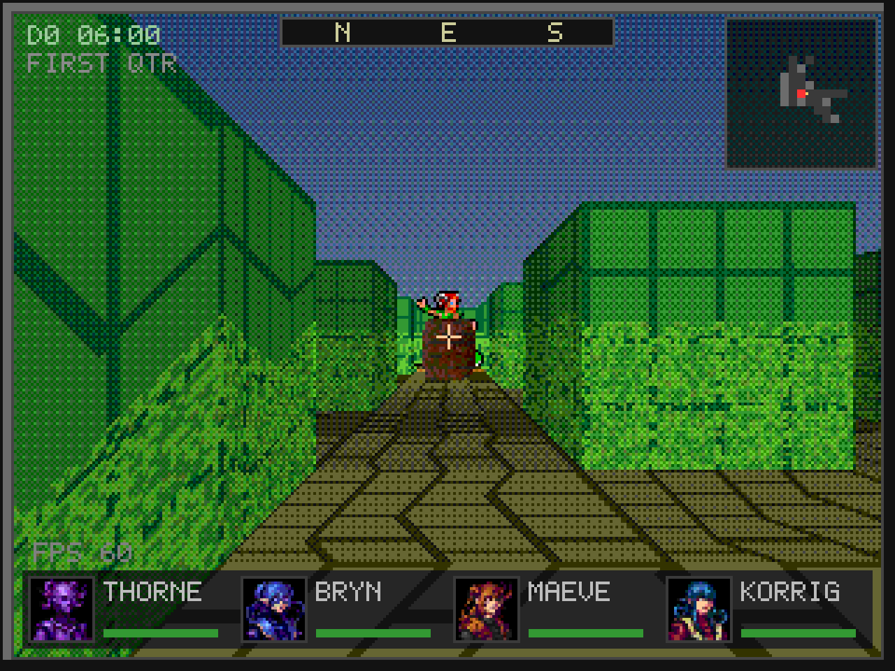 | 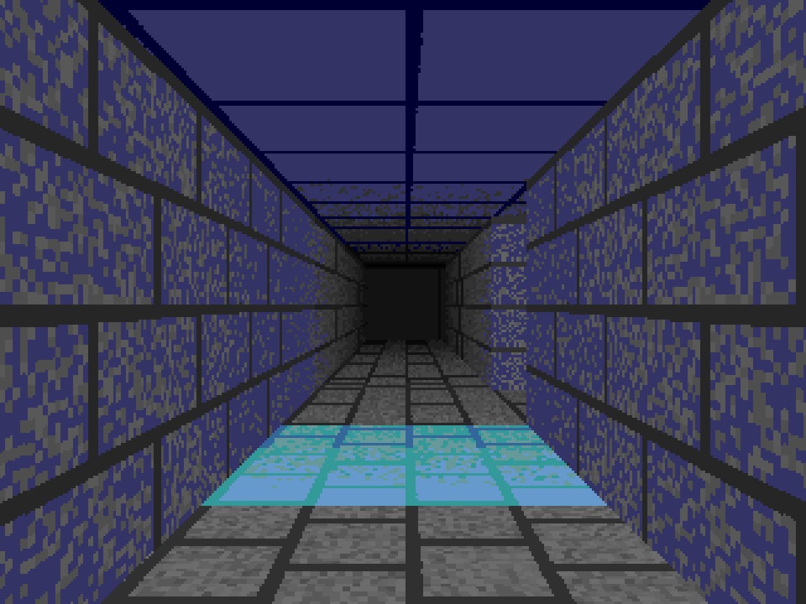 |
| The forest, a hedge avenue running into the fog. | A carved crypt, its floor stepping between heights under the mausoleum kit. |
| 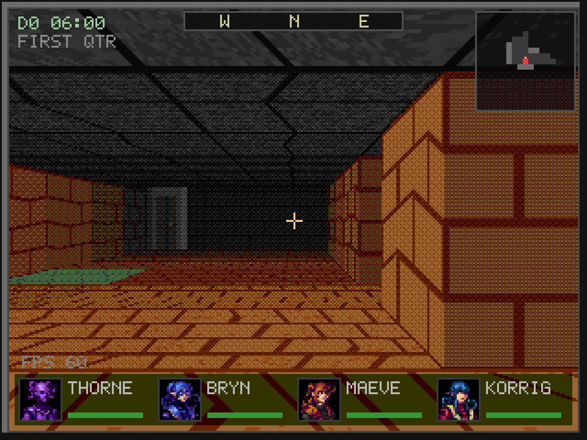 | 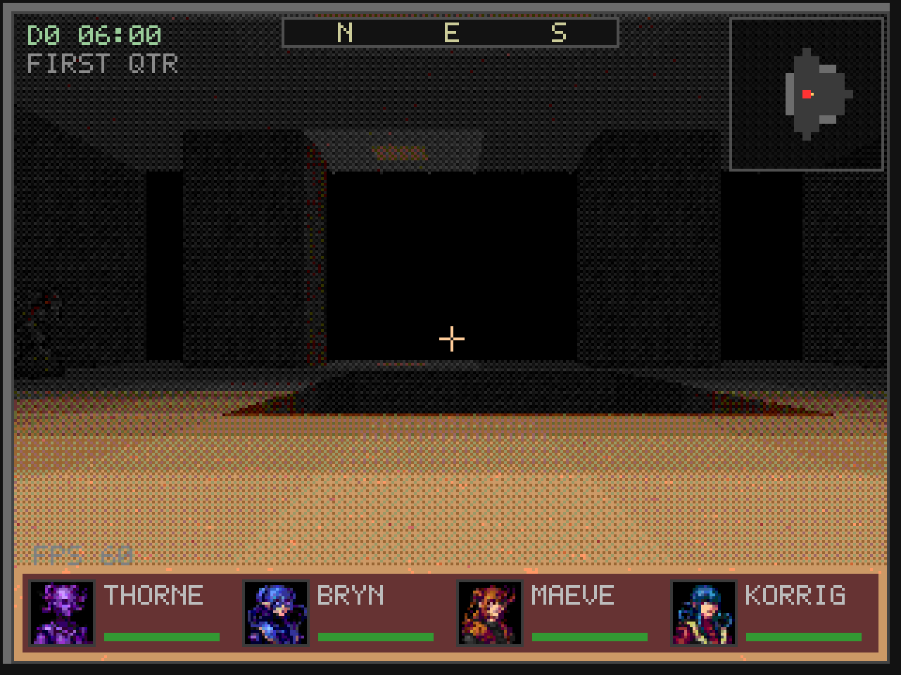 |
| The glowing grotto, a cave of warm stone. | The infernal depth, a rust corridor falling into the dark. |

A generated dungeon carves itself on the kit's module grid, so a procedural
level clads from whole native pieces with no ragged fillers. The cathedral theme
raises a nave and vaulted bays from the same carve.

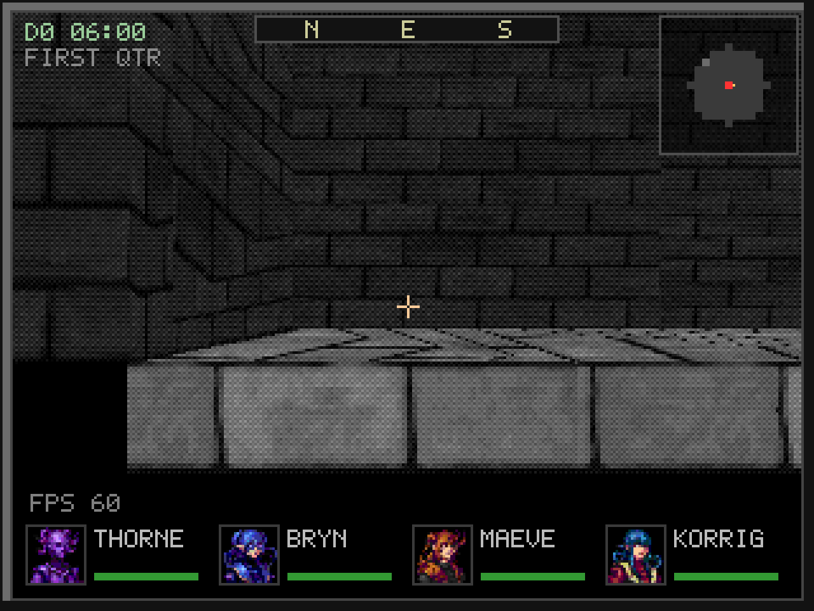

The party meets the folk of each place, runs into what walks the halls, and
fights foes drawn up in two ranks.

| | |
|---|---|
| 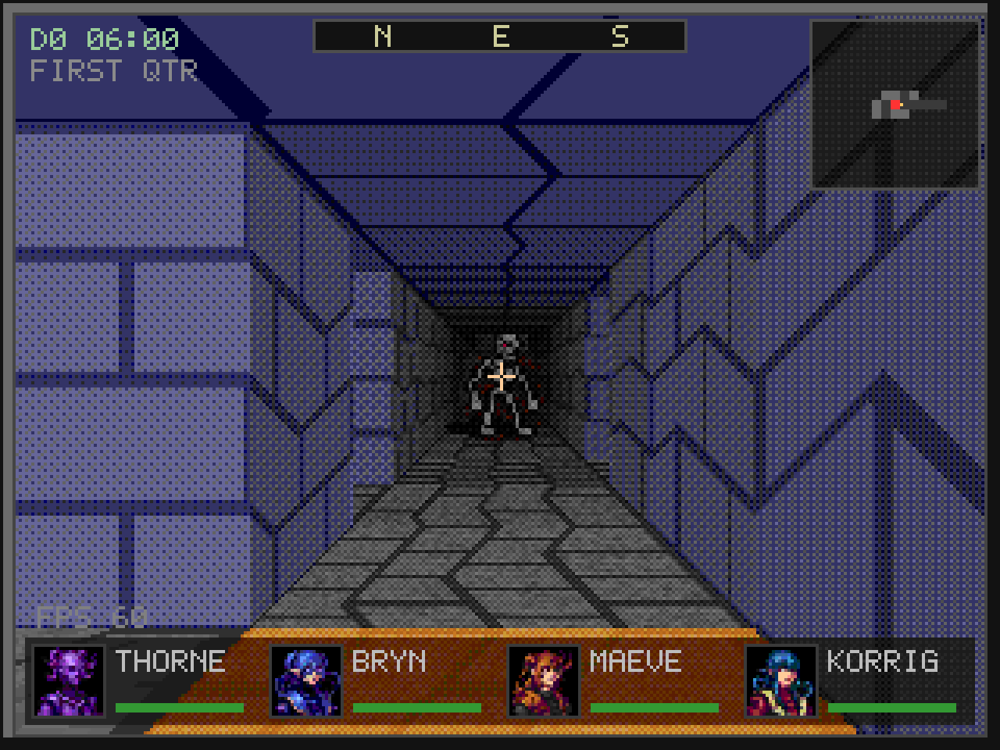 | 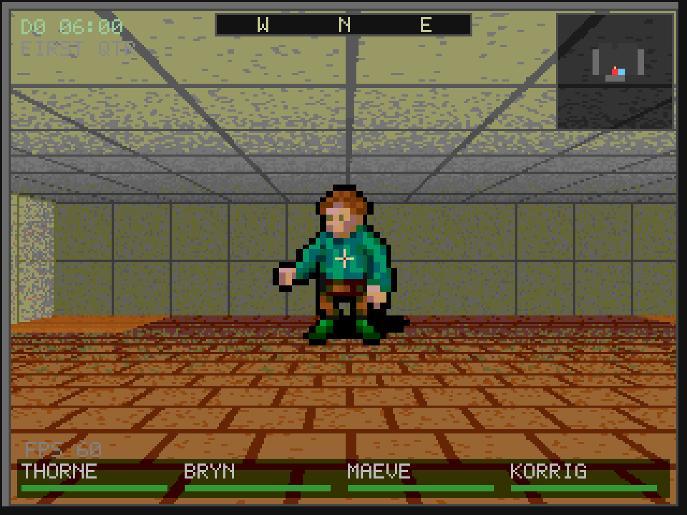 |
| A lone skeleton caught in the torchlight, a hall away. | The tavern keeper, who hires out a sword-arm for a fee. |

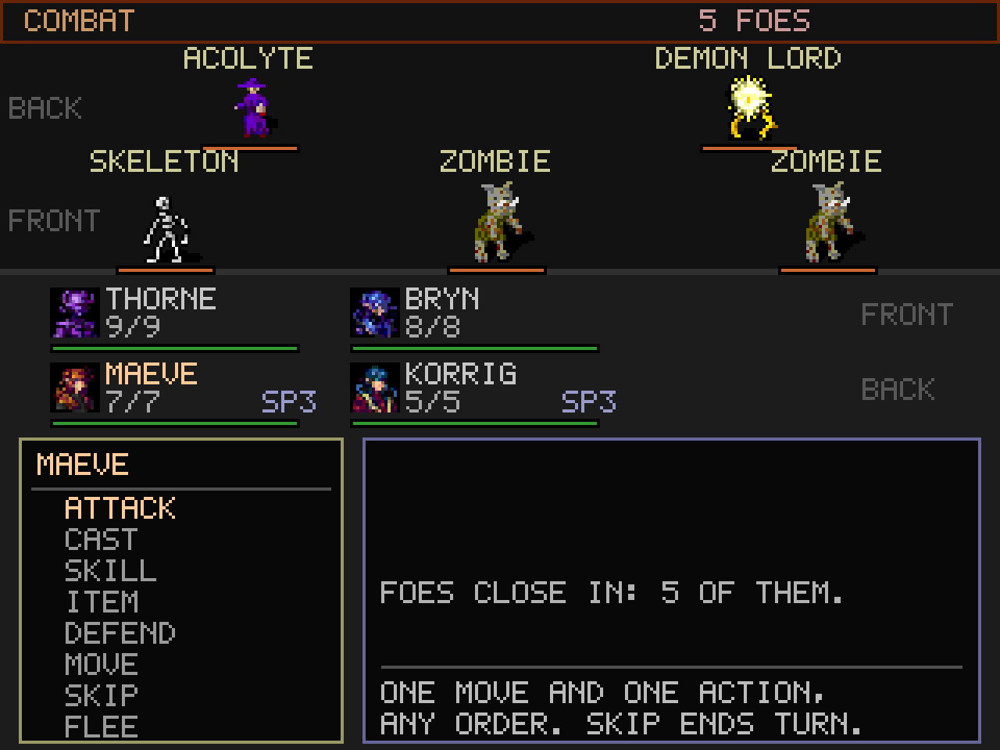

Combat forms two ranks a side. Melee reaches only the front line, so the
acolyte and demon lord hang back while the skeleton and zombies hold the front;
spells and bows strike over them.

## Features

- A PSX-style textured polygon renderer: a software rasterizer draws the tile
  grid as walls, floors and ceilings under distance fog, with baked meshes,
  instanced props and monster meshes in the combat slots. Vertex snap and
  ordered (Bayer) dither give the PlayStation look, and the per-pixel hot path
  runs in fixed point for the FPU-less targets. Textures are mapped affinely,
  and each grid face is subdivided into smaller quads so a straight course
  stays straight at a grazing angle, the way the PlayStation tessellated its
  surfaces. The dither, vertex snap and face subdivision are per-target knobs,
  dense on the desktop and coarse on the hardware targets.
- Turn-based grid movement: step tile by tile and turn in 90 degree steps, each
  tweened so the motion stays smooth. Holding the right mouse button free-looks
  anywhere; stepping or turning realigns the view. A cursor allows clicking the
  scene.
- Six connected zones, each with its own tileset: a town hub, a seaside, a
  forest, a torch-lit crypt, dynamic caves and a glowing grotto, and an
  infernal depth. Each carries authored landmarks, NPCs, lights and hazards.
- A main quest and an ending: three relic shards thread across the crypt, cave
  and infernal zones to the town elder, who gates the victory on all three.
- Placed loot: caches and barrels across the zones hand gold and gear to a
  party that opens them once, the take tracked by a per-tile flag in the save.
- Fog of war: a line-of-sight light radius reveals tiles, which fade to a dim
  remembered state out of sight. A small minimap shows the ground near the
  party, and a fullscreen map shows the whole explored level with droppable
  pins and auto-markers for stairs, portals and NPCs.
- A title screen and character creation for a party of up to four, from
  data-driven species, classes and backgrounds, with a quick-start option.
  Tavern hirelings join for a charisma-eased fee and draw a monthly wage.
- Turn-based combat on the AX&X rules: side initiative, range bands, attacks
  and saves, brush-with-death, morale, guard, spells and potion actions.
  Monsters carry elemental affinities, and worn gear can carry an elemental
  resist mask, so the dragonscale shield halves the demon lord's fire.
- Status effects: poison, fear, paralysis, fighting blind in dim light,
  lingering disease and encumbrance, each surfaced on the party strip.
- Survival pressure tied to rest: a torch burns as a fuel budget and dims the
  view as it gutters, spare torches relight it, and a rest spends a ration per
  living member or the party goes hungry. Traps on marked tiles test a Dodge
  save, deal damage (some of it elemental) and can poison the lead member.
- Keyword dialog with NPCs, a buy shop, story flags and a quest journal. A
  codex records monsters met and item kinds known: a bestiary lists foes with
  their weaknesses, and mystery loot hides its name until used or identified.
- A spell catalog of 170 spells across the Cleric, Druid, and Magic-User
  domains. Each caster class draws from its domain, but a caster commands only
  the spells it has learned: it picks new spells from its domain as it gains
  levels, on a learn screen, and the choices are kept in the save. A spells tab
  on the meta screen lists a caster's known spells by level with each one's
  full effect. In combat its spell menu is the learned, reachable spells, gated
  by level and spell points. Out of combat the SPELLS tab casts too: heals and
  status cures on a chosen member, and party-wide light, read-magic, and
  sense-the-area utility. Spell points are a pool restored by rest, so a caster
  spends down across a delve rather than refilling each fight.
- Arcane schools for the Magic-User list. Each arcane spell belongs to one of
  the eight schools, and a specialist mage (Abjurer, Conjurer, Diviner,
  Enchanter, Invoker, Illusionist, Necronimus, Transmuter) focuses on one:
  barred from its opposition schools but for Lesser Divination, knowing one
  extra spell, and casting its own school at a steeper save. The Wizard and the
  other mage classes stay generalists with the whole list.
- A skills system, the martial side of spells. A character trains non-spell
  abilities with proficiency slots, banked at creation and on level-up and
  generous for the thief kit, spent on a learn-a-skill screen (press T on the
  character sheet) to learn a skill or rank it up. Exploration skills roll a
  d20 check in the world: a party lockpick opens a locked door, a trapfinder
  disarms a trap before it springs, a quiet party slips past a wandering foe,
  and First Aid mends a member between rests. Combat maneuvers resolve in a
  fight through a SKILL command and cost no resource: Power Attack, Disarm,
  Shield Bash, Aimed Shot, and Rally, with the strongest limited to a few uses
  per encounter. Each skill carries a pixel icon, shown on the sheet, the learn
  screen, and the combat menu. Trained skills and unspent slots are saved.
- Save and load of the whole game, including the party, gold, flags, journal,
  position and the explored fog of every visited map.
- Roguelike dynamic maps (rooms, caves, mazes) generated from a seed. The
  version and seed are stored in the save, so a level regenerates identically
  and its explored fog persists across visits.
- Dungeons descend level by level beneath a seeded overworld, reached through
  cave mouths on the surface. Deeper levels are harder, and at thirty levels
  down a dungeon breaks into the Sunless Depths, a world-spanning cavern.
  Cross-map auto-travel routes the party over portals, and roaming monsters
  can hunt it across maps on the game clock.
- A main quest arc: the elder sets the party to gather three shards of an old
  relic from the crypt, the grotto and the infernal deep. Made whole, the
  relic proves to be a key, not a ward. The arc builds to its capstone in the
  descent to the Sunless Depths, where the key opens the gate to the first of
  the drowned cities the title names.
- A game clock drives a day-night cycle that lights and darkens outdoor maps,
  and a 29.53 day moon. A full moon transforms characters cursed with
  lycanthropy even underground. Skylight and moonwell tiles admit light into
  dark places for light puzzles. The clock and moon show on the HUD and save.
- A software audio mixer with sound-effect channels and synth music, plus
  optional module music through libxmp when the library is present. Effects
  are generated at startup, so no audio files are required, and the game runs
  silently if no sound device is found.
- Options for master, music and effect volume, difficulty and accessibility
  (permadeath versus temple revival, combat speed, the optional natural-20/1
  critical rules), and a key-rebinding screen, all stored beside the save.

## Controls

The core exploration keys are rebindable in Options; the defaults are below.

| Input | Action |
|-------|--------|
| W / S | Step forward / back one tile |
| A / D | Strafe one tile left / right |
| Q / E | Turn 90 degrees left / right |
| Space | Interact: open a door ahead, talk to an NPC, or open a cache |
| Mouse | Move the cursor over the scene |
| Left click | Interact with the tile under the cursor |
| Right button (hold) | Free look; stepping or turning realigns the view |
| Tab | Open or close the fullscreen map |
| M | Toggle the small minimap |
| J | Open the journal, quest log and bestiary |
| R | Rest to recover health, when no foe is near |
| G | Recall and auto-travel toward a known destination |
| O | Enter the coarse overworld travel mode |
| C | Force a test encounter (while a party exists) |
| F5 / F9 | Save / load the game |
| Esc | Back out of a screen, or quit from exploration |

## Requirements

- Free Pascal Compiler (fpc) 3.2 or newer.
- The SDL2 runtime shared library, loaded at runtime with dlopen or the system
  equivalent, so no `-dev` package or Pascal SDL bindings are needed. The game
  looks for the platform's usual name: `libSDL2-2.0.so.0` on Linux, `SDL2.dll`
  on Windows, `libSDL2.dylib` on macOS. On Debian or Ubuntu:
  `sudo apt install libsdl2-2.0-0`.
- libxmp is optional. When present it plays module music; without it the game
  falls back to the built-in synth and runs fine.

## Build and run

```sh
make        # builds build/crawler and build/game.pak
make run    # builds and runs
make test   # builds and runs the test suite
make clean  # removes the build directory
```

The Makefile auto-discovers `src/*.pas`, the maps in `content/maps/*.map`, and
the tests in `tests/t_*.pas`, so new files are picked up without editing it.
The same `make` works on Linux, Windows and macOS; each host compiles for
itself.

The program is relocatable. It finds `game.pak` next to its own executable
(resolved through the real binary path, so a launch by name on the PATH or
through a symlink still works), and it falls back to a macOS `.app` bundle's
Resources, a unix install prefix, and the development tree. Saves and settings
go to a per-user directory (`~/.config/crawler`, `~/Library/Application
Support/crawler`, or `%APPDATA%\crawler`), so a read-only install still works.
A `portable.txt` beside the binary keeps everything in one folder instead.

### Running a downloaded macOS build

The macOS archive holds a self-contained `Crawler.app` that bundles SDL2, so it
needs no Homebrew. It is not notarized by Apple, though, so Gatekeeper
quarantines it on download. The first launch reports that macOS "could not
verify" the app is free of malware and offers only Move to Trash or Done. To
run it, clear the quarantine attribute on the app, then open it:

```sh
xattr -dr com.apple.quarantine crawler-*-macos-aarch64/Crawler.app
open crawler-*-macos-aarch64/Crawler.app
```

Opening the app once and then choosing Open Anyway under System Settings,
Privacy and Security also works.

## Continuous integration

`.github/workflows/ci.yml` builds the game and runs the full test suite on
Linux, Windows and macOS through a GitHub matrix. `.gitlab-ci.yml` runs the
same build and test on Linux on GitLab's shared runners, since the repository
lives on GitLab and its free runners are Linux only.

## Layout

The platform layer and core:

| File | Role |
|------|------|
| `crawler.lpr` | Platform layer: SDL setup, window, frame loop, framebuffer upload. |
| `src/sdl2min.pas` | Minimal runtime binding to the SDL2 shared library. |
| `src/xmpmin.pas` | Minimal libxmp binding, loaded at runtime for module music. |
| `src/apppaths.pas` | Relocatable asset search and the per-user save directory. |
| `src/gfx.pas` | Framebuffer, drawing primitives and the bitmap font. |
| `src/fixedpt.pas` | Signed 16.16 fixed-point math for the rasterizer hot path. |
| `src/rng.pas` | Deterministic xorshift PRNG with independent streams. |
| `src/pak.pas` | Pack archive reader, plus a writer for the tools. |
| `src/pic.pas` | Custom image codec (PackBits, direct or indexed colour). |
| `src/pcportrait.pas` | Player-character portrait pool: cache and keyed blits. |
| `src/spellicon.pas` | Spell icon pool: cache and scaled keyed blits. |
| `src/skillicon.pas` | Skill icon pool: cache and scaled keyed blits. |
| `src/game.pas` | Top-level state machine: routes input, update and render. |
| `src/gamestate.pas` | Shared cross-state globals for the UI units. |

Rendering:

| File | Role |
|------|------|
| `src/raster.pas` | A small fixed-function polygon rasterizer, PSX style. |
| `src/meshfmt.pas` | Baked triangle mesh format, drawn by the polygon renderer. |
| `src/heightfmt.pas` | Baked terrain heightmap format, the source for outdoor relief. |
| `src/terrain.pas` | Outdoor terrain heightfield layer, drawn as relief on surface maps. |
| `src/models.pas` | Registry of baked meshes the polygon renderer instances. |
| `src/roomdb.pas` | A hand-placed modular-tile room: the theme G pre-format proof. |
| `src/polyrender.pas` | Draws the tile grid as textured polygons via the rasterizer. |
| `src/clad.pas` | Cladding pass: draws a tileset's sectors from its modular kit meshes at native scale. |
| `src/tilekit.pas` / `src/kittext.pas` | Per-tileset modular kit definitions, and the kit-text parser. |
| `src/textures.pas` | Runtime texture cache, loaded from the pak. |
| `src/sprites.pas` | Runtime store of billboard sprites (monsters, NPCs) from the pak. |
| `src/worldspr.pas` | Gathers the world-view billboard sprites for the polygon renderer. |
| `src/texgen.pas` | Procedural texture and per-zone tileset generation (tool side). |
| `src/hud.pas` | Border, compass, crosshair, minimap and full map. |

World, maps and navigation:

| File | Role |
|------|------|
| `src/world.pas` | Active map grid, camera, movement and collision. |
| `src/mapfmt.pas` | Compiled map format: wall grid plus a sector height layer. |
| `src/maptext.pas` | Parser for the human-authored text map format. |
| `src/mapstate.pas` | Per-map fog, door and seed snapshots across visits. |
| `src/mapgen.pas` | Seeded roguelike generators (rooms, cave, maze). |
| `src/gridgen.pas` | Grid toolkit shared by the generators. |
| `src/carve.pas` | Carves and repairs maps on a kit's module grid so they clad from native pieces. |
| `src/overworld.pas` | The seeded overworld terrain and biomes. |
| `src/worldarea.pas` | Encounter areas and their names. |
| `src/worldname.pas` | Names of the synthesized overworld maps. |
| `src/worldfmt.pas` / `src/worldtext.pas` | Manifest of dynamic (generated) maps, and its text parser. |
| `src/worldload.pas` | Map and session loading, and the save path. |
| `src/pathfind.pas` | Grid pathfinding (A*) over a single map. |
| `src/maproute.pas` | Cross-map routing over portal links. |
| `src/pursuit.pas` | Roaming monsters that hunt the party across maps. |
| `src/mappins.pas` | Player pins and auto-markers on the full map. |

Gameplay systems and content tables (each `*text` unit is the tool-side parser):

| File | Role |
|------|------|
| `src/rules.pas` | AX&X rules math: abilities, classes, dice resolution. |
| `src/dice.pas` | A small dice and arithmetic expression evaluator. |
| `src/party.pas` | Characters, derived stats and character creation. |
| `src/beings.pas` | Shared traits common to party, NPCs and monsters (gender). |
| `src/chardata.pas` / `src/chartext.pas` | Species, class and background tables. |
| `src/items.pas` / `src/itemtext.pas` | Item database and table codec. |
| `src/monsters.pas` / `src/montext.pas` | Monster database and table codec. |
| `src/combat.pas` | Combat turn-order driver: initiative, pacing and the action procedures. |
| `src/combatstate.pas` | The shared fight state every combat unit reads and writes. |
| `src/combatcore.pas` | Leaf combat logic: hit resolution, tactics, status and spell effects. |
| `src/combatai.pas` | The foe side's AI: how a monster moves, harries, casts or holds. |
| `src/encounters.pas` / `src/enctext.pas` | Encounter tables. |
| `src/shops.pas` / `src/shoptext.pas` | Shop stock tables. |
| `src/dialog.pas` / `src/dialogtext.pas` | Conversation data, decoder and runtime. |
| `src/spelldb.pas` / `src/spelltext.pas` | Spell catalog, decoder and table codec. |
| `src/spellbook.pas` | Known spells: the per-caster learned list and its rules. |
| `src/fieldcast.pas` | Out-of-combat casting: the SPELLS tab heals, cures, refuels and reveals. |
| `src/skilldb.pas` / `src/skilltext.pas` | Skill catalog, decoder and table codec. |
| `src/skillbook.pas` | Trained skills: proficiency slots, ranks and checks. |
| `src/flags.pas` | Story flags and the quest journal. |
| `src/codex.pas` | Bestiary and item identification knowledge. |
| `src/save.pas` | Save and load of the whole game to a file. |
| `src/gametime.pas` | The game clock, day-night cycle and the moon. |
| `src/audio.pas` | Software mixer: procedural SFX and music channels. |
| `src/settings.pas` | Player settings file beside the save. |
| `src/keymap.pas` | Rebindable key bindings for the core actions. |

UI states and tools:

| File | Role |
|------|------|
| `src/ui/*.pas` | The per-state screen units, one per game state, routed from `game`. |
| `src/ui/titleui.pas` | Title menu, pregen party and the quick entry points. |
| `src/ui/charcreateui.pas` | Character creation screen. |
| `src/ui/exploreui.pas` | First-person exploration, interaction, traps and lighting. |
| `src/ui/combatui.pas` | The combat screen and its input. |
| `src/ui/dialogui.pas` | NPC conversation over the frozen view. |
| `src/ui/shopui.pas` | The buy shop screen. |
| `src/ui/overworldui.pas` | Coarse overworld travel. |
| `src/ui/fullmapui.pas` | The full-map overlay, pins and auto-travel picking. |
| `src/ui/menuui.pas` | The J menu: journal, bestiary and the spells tab's field casting. |
| `src/ui/charsheetui.pas` | The character sheet, spell browser, first aid and skill training door. |
| `src/ui/learnspellui.pas` | The learn-a-spell screen. |
| `src/ui/learnskillui.pas` | The train-a-skill screen. |
| `src/ui/optionsui.pas` | The options screen. |
| `src/ui/keybindui.pas` | The key-binding sub-screen. |
| `src/ui/gameoverui.pas` | The game-over screen. |
| `src/ui/victoryui.pas` | The victory screen. |
| `src/uihelp.pas` | Shared centered and word-wrapped text helpers. |
| `tools/mkassets.pas` | Offline tool: builds `game.pak` from generated art and tables. |
| `tools/mkmesh.pas` | Bakes an OBJ plus a texture into a mesh lump. |
| `tools/meshshot.pas` | Renders a baked mesh to a PPM for inspection. |
| `tools/shot.pas` | Headless screenshot tool: renders the real game offscreen to a PPM. |

## Notes

Maps live in `content/maps/*.map` as text and are compiled into `game.pak` by
the asset tool. Each map is a grid of tile characters: `0` is open floor,
`1`-`3` select wall textures (brick, stone, moss) and `4` is a door. The wall
and floor colours come from the zone's tileset, chosen by the map's area, so
the same tile characters theme differently per zone. A map also names entry
markers and portals that move the party to another map, so the world is several
maps loaded on demand rather than one hardcoded grid, along with lights, traps,
props and loot caches placed by tile.

All tunable content lives in `content/*.txt` and compiles into the pak, not in
Pascal branches, so the tables (items, monsters, species, classes, encounters,
shops, dialog, the world manifest) can be edited without touching the engine.
